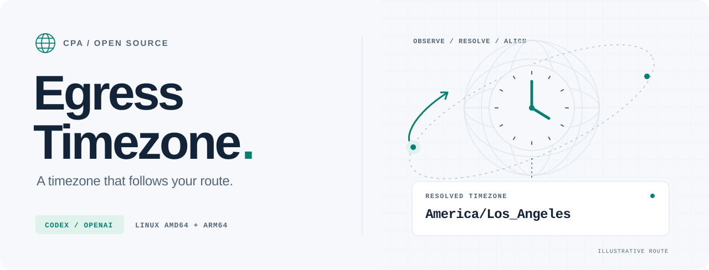

<picture>
  <source media="(prefers-color-scheme: dark)" srcset="assets/hero-dark.svg">
  <source media="(prefers-color-scheme: light)" srcset="assets/hero-light.svg">
  
</picture>

<div align="center">

# A timezone that follows your route.

Adapt Codex / OpenAI timezone declarations to the **observed egress IP** of the account selected by CPA.

[](https://github.com/Renwang-Huang/cpa-egress-timezone/releases/latest) [](https://github.com/Renwang-Huang/cpa-egress-timezone/actions/workflows/ci.yml) [](docs/INSTALLATION.en.md#compatibility) [](LICENSE)

[简体中文](README.md) · **English**

[Quick start](#quick-start) · [Config](docs/CONFIGURATION.en.md) · [Design](docs/DESIGN.md) · [Releases](https://github.com/Renwang-Huang/cpa-egress-timezone/releases/latest)

</div>

---

## Every account. Its own timezone.

When CPA routes accounts through different proxies, a client's declared timezone can differ from its exit location. Egress Timezone resolves the selected account's route, probes the public IP observed by its upstream, and aligns supported environment declarations with that IP's IANA timezone.

- **Follow the account** — Resolve the selected credential's proxy and origin; cache observations by route.
- **Refresh on demand** — Route observations last 60 seconds by default; the next request refreshes an expired entry.
- **Preserve meaning** — Rewrite supported timezone declarations; preserve the request on lookup failure by default.

## Quick start

Requires **CPA v8.0.47** as the compatibility baseline, with dynamic plugins enabled, on **Linux amd64 / arm64 · glibc**. [Other installation methods →](docs/INSTALLATION.en.md)

### 1. Add the store source

Merge these fields into your existing CPA configuration, preserving other sources and settings:

```yaml
plugins:
  enabled: true
  store-sources:
    - https://raw.githubusercontent.com/Renwang-Huang/cpa-egress-timezone/main/store/registry.json
```

### 2. Install and enable

Open **Plugins → Store** in CPA's management UI, refresh, and install **Egress Timezone**. Merge these settings into the same `plugins` section:

```yaml
plugins:
  configs:
    egress-timezone:
      enabled: true
      priority: 1000
      mode: auto
      cpa_config_path: /CLIProxyAPI/config.yaml
```

Use the actual path **inside CPA's runtime or container**. The plugin needs to read the configuration and, for file-backed OAuth accounts, the selected credential JSON. Disable the older `los-angeles-timezone` plugin using the [migration guide](docs/INSTALLATION.en.md#migrate-from-the-older-plugin).

### 3. Inspect an observation

After sending a normal request, query the authenticated status endpoint:

```bash
curl --fail --silent --show-error \
  -H "Authorization: Bearer $CPA_MANAGEMENT_KEY" \
  http://127.0.0.1:8317/v0/management/plugins/egress-timezone/status
```

Check `ip`, `timezone`, `expires_at`, and `last_error` in `observations`. Use your own deployment address and management key. [Configuration & troubleshooting →](docs/CONFIGURATION.en.md)

## What changes

If the selected account's upstream probe IP maps to `America/Los_Angeles`, the request's environment block is adjusted like this:

```diff
 <environment_context>
-  <timezone>Asia/Hong_Kong</timezone>
+  <timezone>America/Los_Angeles</timezone>
 </environment_context>
```

| Content | Behavior |
| :--- | :--- |
| Environment `<timezone>` tags and supported explicit timezone fields | Align with the observed IP's IANA timezone |
| `<current_date>` in the latest environment block | Convert only when it is today in the original timezone and that timezone is unambiguous |
| Existing explicit timezone headers | Adjust in the after-auth hook; no new timezone headers are added |
| Ordinary text, tool arguments/results, encrypted reasoning, assistant history, historical dates | Preserve |
| `User-Agent`, `Originator`, `Authorization`, account and route settings | Preserve |

Embedded IANA tzdata handles daylight saving and date boundaries without changing the host or container timezone.

## How it works

1. **Select the route** — Read `selected_auth_id` in the after-auth hook and resolve the account's proxy and upstream origin.
2. **Observe the exit** — Request the upstream's `/cdn-cgi/trace` through that route and read the returned public IP.
3. **Resolve the timezone** — Query GeoIP for that observed IP and cache the IP → IANA timezone mapping.
4. **Align the request** — Rewrite supported declarations, refresh expired observations, and preserve the request on failure by default.

> [!IMPORTANT]
> A probe uses a separate connection and cannot attest the exit of every model request. Automatic mode requires equivalent probe/model routing and an exit that stays stable within the cache window. Per-connection rotation, destination routing, request proxy overrides, or another forwarding gateway can produce different exits. See [design and accuracy limits](docs/DESIGN.md) (中文).

The default GeoIP service receives only the observed public IP, without model bodies, account tokens, or client identity headers. You can configure a compatible service of your own. [Full configuration →](docs/CONFIGURATION.en.md)

## Documentation & development

| Guide | Contents |
| :--- | :--- |
| [Installation & migration](docs/INSTALLATION.en.md) | Release packages, source builds, platform requirements, migration, rollback |
| [Configuration](docs/CONFIGURATION.en.md) | Every option, fixed mode, diagnostics, troubleshooting |
| [Example configuration](examples/plugin-config.yaml) | Complete settings to merge into an existing CPA configuration |
| [Design](docs/DESIGN.md) (中文) | Route resolution, caching, rewrite scope, accuracy limits |
| [Verification](docs/VERIFICATION.md) (中文) | Both architectures, isolated integration, live probes, known limits |
| [Publishing](docs/PUBLISHING.md) (中文) | Releases, custom sources, official store submission |

```bash
go test -race -count=1 ./...
go vet ./...
bash scripts/build.sh
python3 scripts/integration.py
```

Integration uses an isolated CPA container, mock upstream, and fake credentials. It covers HTTP, streaming, WebSocket, account routes, and failure handling without calling real model APIs. Synthetic results do not verify production egress. See [development verification](docs/INSTALLATION.en.md#development-verification) for opt-in live probes.

---

<div align="center">

[MIT](LICENSE) · Created by [Renwang Huang](https://github.com/Renwang-Huang) · [Third-party notices](THIRD_PARTY_NOTICES.md)

</div>
