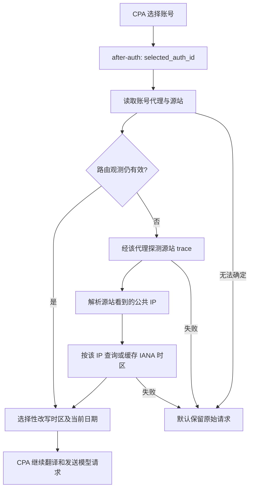

# 原理与准确性边界

## 数据路径

自动模式不在 `request.normalize` 阶段提前固定时区，因为那里没有选中凭据。
`request.intercept_after` 在每次选择账号后运行；它处理的是 CPA 此时提供的正文，
可能仍是客户端原始协议，所以规范化同时支持 Responses 和 Chat 的结构。
固定模式也可在 normalizer 阶段运行，日期处理保持幂等。

## 路由来源与支持范围

代理优先级为宿主明确提供的 `request_proxy_url`（若存在且非空）、账号 `proxy-url`、
全局 `requests.proxy-url`（旧字段 `proxy-url`）、默认环境代理。
支持 HTTP、HTTPS、SOCKS5、SOCKS5H 与 `direct` / `direct://` / `none`。
插件不会修改 CPA 的代理配置。

支持的凭据来源：

- Codex API key：根据 CPA v8.0.47 的稳定 ID 约定匹配，默认源站为 `chatgpt.com`。
- Codex OAuth 文件：以选中 auth ID 读取 auth-dir 下的普通 `.json` 文件；默认源站为
  `chatgpt.com`。文件 metadata 中的任意 `base_url` 不作为宿主已应用的路由属性。
- OpenAI compatibility：匹配已配置源站和 API key 项，包含无 key 的兼容条目。
- legacy 字段与 v8 分组字段：v8 对应字段存在时优先，即使值为空；Codex 分组的
  prefix、proxy、headers 按宿主继承语义展开。

不支持无法从本地文件与配置恢复路由的动态凭据、自定义 executor、加密文件、
Home 远程下发账号、自定义 RoundTripper。选中 ID 不匹配时跳过，不能猜测成全局出口。

## 探测究竟证明什么

默认请求源站 `/cdn-cgi/trace`，仅接受公共 IP，不信任下游传入的 `X-Forwarded-For`。
GeoIP 查询参数使用 trace 返回的 IP，并要求响应 IP 一致且包含可加载的 IANA 时区。
HTTP 不重定向，不转发模型令牌、cookie、Originator 或模型正文；正文上限 64 KiB。

一次成功探测证明：**那个探测请求在那个时间被探测端点观察到的 IP**。
缓存中的后续请求使用的是该观测，不能称为逐请求出口证明。

不能由单个纯插件保证的情形包括：

1. 代理每条连接轮换、连接池的存量连接、IPv4/IPv6 分别出口。
2. 按目标域名、URL 路径、TLS 指纹、HTTP 与 WebSocket 类型分流。
3. CPA SDK 使用请求级 ProxyURL：v8.0.47 的钩子没有可靠暴露该执行选项；
   插件不能自动检测未暴露的覆盖。使用该功能的部署应禁用自动模式。
4. 操作系统透明代理、注入的自定义传输策略、配置文件与宿主内存状态短时不同步。
5. CPA 先请求另一个转发网关：trace 只能观测 CPA → 网关这一跳；无法推导
   网关 → 模型提供方的最终出口。
6. 自定义源站没有 trace、探测端点限流/挑战、GeoIP 数据错误或缺失。

`probe_url` 可适配受控端点，但操作者需要验证路由等价性。
`address_family` 仅能约束直接连接的拨号；代理控制自己对目标的地址选择，
因此显式代理配合非 auto 族会安全跳过。不能靠改变探测族修复 CPA 的 IPv6 行为。

如果业务要求每条模型连接严格一致，需要固定出口，并在负责真实上游传输的
组件中记录/验证该连接的出口；仅有请求改写钩子无法提供这个保证。

## 失败、性能与状态

- 首次或到期请求进行有界同步探测，最多增加配置的总查询预算（默认 4 秒）。
  相同路由的并发未命中合并查询；其他等待者也有独立预算。
- 60 秒的路由 TTL 只在有请求时刷新，没有后台轮询。TTL 内出口改变不会立即发现。
- IP → 时区默认缓存 6 小时；换 IP 时立即选择相应映射，不需要等待 GeoIP TTL。
- 路由和 GeoIP 缓存各自有容量上限，冷缓存路由被逐出。
- 失败进入冷却；过期观测不再用于改写。旧 IP/时区仍可作为历史诊断显示。
- 显式配置 `fallback_timezone` 时，失败使用它；默认不设置。
- 状态只含散列路由标识、IP、时区、时间和固定错误文本，不含账号 ID、代理凭据、
  CPA 文件路径或原始正文。应使用 CPA 管理鉴权限制访问。
- 不持久化探测结果，不记录请求正文，不自动更改系统或生产配置。

## 改写边界

本项目是环境声明一致性工具。它不会删除所有历史信息，不会验证使用者的地理位置，
也不会更改服务器实际出口或网络协议特征。普通文本、路径、工具输出中的时区/位置
可能仍存在，保持原始语义优先。
